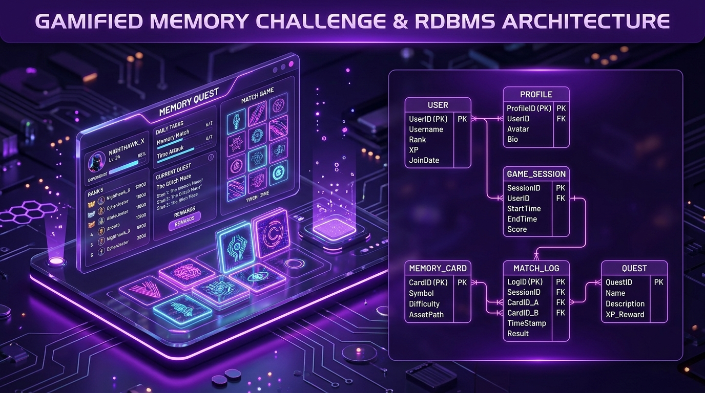
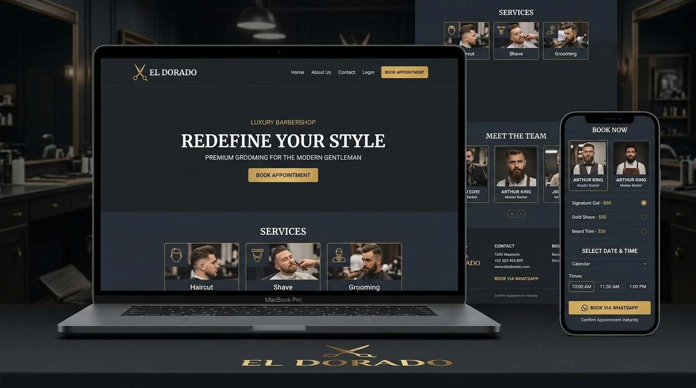
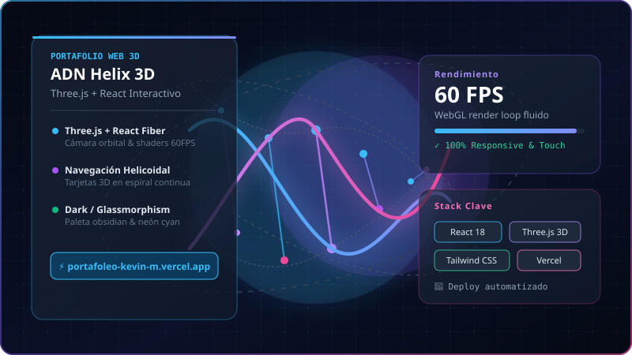

<div align="center">

  <!-- Header Banner (Adaptive Dark / Light Mode) -->
  <picture>
    <source media="(prefers-color-scheme: dark)" srcset="assets/banner-dark.svg">
    <source media="(prefers-color-scheme: light)" srcset="assets/banner-light.svg">
    
  </picture>

  <br><br>

  <!-- Quick Social & Interactive Badges -->
  <p align="center">
    <a href="https://portafoleo-kevin-m.vercel.app/" target="_blank">
      
    </a>
    <a href="https://www.linkedin.com/in/kevin-mora94aa5738b" target="_blank">
      
    </a>
    <a href="https://wa.me/573118283129?text=Hola%20Kevin%2C%20vi%20tu%20portafolio%20y%20quiero%20hablar%20contigo." target="_blank">
      
    </a>
    <a href="mailto:Kevinmora2838@gmail.com">
      
    </a>
    
  </p>

  <p align="center">
    <strong>📍 Piedecuesta, Santander, Colombia</strong> · 
    <strong>🎓 Aprendiz SENA ADSO (Ficha 3172526)</strong> · 
    <strong>⚡ Disponibilidad: Patrocinio SENA & Freelance</strong>
  </p>

</div>

---

### 🧬 Sobre Mí

Soy **Kevin Gregorio Mora Perez**, desarrollador **Full-Stack Junior** enfocado en la construcción de **backends robustos con Node.js y bases de datos relacionales íntegras en PostgreSQL**, combinados con interfaces modernas, intuitivas y de alto rendimiento en **React y Next.js**.

Actualmente curso el tecnólogo en **Análisis y Desarrollo de Software (ADSO)** en el **SENA C.A.S.A. (Centro Agroempresarial y de Servicios Ambientales)** en Piedecuesta, Santander. Cuento con formación previa como **Técnico en Desarrollo de Software** y bachillerato académico con énfasis agroecológico, lo que me ha formado un pensamiento rigurosamente lógico, orientado a la resolución de problemas y al aprendizaje autodidacta ágil.

```yaml
nombre: Kevin Gregorio Mora Perez
rol: Desarrollador Full-Stack Junior
especialidad: Stack PERN (PostgreSQL · Express · React · Node.js)
enfoque_actual: Arquitectura de bases de datos relacionales, optimización SQL y experiencias 3D
estado: 🟢 Buscando empresa patrocinadora para etapa práctica SENA & proyectos freelance
respuesta_contacto: Menos de 24 horas garantizado
```

<details>
  <summary><b>🔍 Conoce más detalles sobre mi perfil y metodología</b></summary>
  <br>

  - 🎯 **En qué destaco:** Diseño de diagramas entidad-relación (ERD) en DBML, normalización relacional hasta 3FN, endpoints seguros con Node.js/Express y maquetación de landings orientadas a conversión inmediata.
  - 💡 **Filosofía de código:** *"Bases de datos limpias, arquitectura predecible y cero fricción para el usuario final"*.
  - 🗣️ **Idiomas:** Español (Nativo) · Inglés Técnico (Nivel A2 - comprensión de documentación y especificaciones técnicas).
  - 🧩 **Habilidades humanas:** Proactividad radical, adaptabilidad inmediata a nuevos frameworks, rigor metodológico con Scrum y comunicación abierta en equipo.
</details>

---

### 🛠️ Stack Tecnológico & Herramientas

<p align="center">
  
</p>

<table width="100%">
  <thead>
    <tr>
      <th width="28%">Área</th>
      <th width="42%">Tecnologías Principales</th>
      <th width="30%">Especialidad / Enfoque</th>
    </tr>
  </thead>
  <tbody>
    <tr>
      <td>⚙️ <b>Backend & APIs</b></td>
      <td><code>Node.js</code>, <code>Express.js</code>, <code>REST APIs</code>, <code>JWT</code>, <code>UUID</code></td>
      <td>Arquitectura modular MVC, manejo de middleware, sesiones seguras con UUID y respuestas tipadas.</td>
    </tr>
    <tr>
      <td>🗄️ <b>Bases de Datos</b></td>
      <td><code>PostgreSQL</code>, <code>MySQL</code>, <code>DBML</code>, <code>JSONB</code>, <code>SQL DDL/DML</code></td>
      <td>Modelado relacional robusto, integridad referencial con FKs, analítica en tiempo real con JSONB e indexación.</td>
    </tr>
    <tr>
      <td>🎨 <b>Frontend & Web 3D</b></td>
      <td><code>JavaScript (ES6+)</code>, <code>React 18</code>, <code>Next.js 15</code>, <code>Three.js</code>, <code>Tailwind CSS 4</code></td>
      <td>Interfaces reactivas, Server Components, visualizaciones 3D por WebGL a 60 FPS y microinteracciones fluidas.</td>
    </tr>
    <tr>
      <td>🧰 <b>DevOps & Herramientas</b></td>
      <td><code>Git</code>, <code>GitHub</code>, <code>Vercel</code>, <code>Postman</code>, <code>Scrum</code>, <code>VS Code</code></td>
      <td>Control de versiones colaborativo con Git, pruebas de endpoints en Postman y despliegues CI/CD en Vercel.</td>
    </tr>
  </tbody>
</table>

---

### 🚀 Proyectos Destacados

#### 1. Memorize Evolutivo — *Arquitectura Relacional & Backend Gamificado*
> **Especialidad:** Backend & Diseño de Base de Datos · `Node.js` `Express` `PostgreSQL` `DBML`

<p align="center">
  <a href="https://github.com/kevinmora18" target="_blank">
    
  </a>
</p>

- **El Reto:** Modelar una base de datos relacional de nivel productivo para un sistema de juego de memoria gamificado con progresión, rangos competitivos, misiones diarias y eventos en tiempo real sin saturar la persistencia tradicional.
- **Solución Técnica:**
  - 🗄️ **Base de datos de 23 tablas interconectadas** con restricciones de llave foránea (`ON DELETE CASCADE / SET NULL`) garantizando 100% de integridad referencial.
  - 🔑 **Migración a identificadores únicos globales (UUID)** en lugar de IDs secuenciales para prevenir enumeración maliciosa en sesiones y perfiles de jugadores.
  - 📊 **Campos JSONB en PostgreSQL** dentro de `game_events` para analítica de eventos semi-estructurados en tiempo real sin requerir costosas tablas satélite.
  - 🎮 **Lógica de negocio gamificada:** Sistema de recompensas XP, cálculo de rangos y rotación de misiones diarias modelado directamente en el esquema relacional.
- **Enlaces:** [Repositorio en GitHub](https://github.com/kevinmora18)

---

#### 2. Barbería El Dorado — *Landing Page de Alta Conversión & Agendamiento Express*
> **Especialidad:** Frontend UI/UX & Conversión · `Next.js 15` `Tailwind CSS 4` `WhatsApp Business API` `Vercel`

<p align="center">
  <a href="https://proyecto-barber-tan.vercel.app/" target="_blank">
    
  </a>
</p>

- **El Reto:** Un negocio local requería digitalizar sus reservas sin costos mensuales de backend, bases de datos complejas ni barreras de registro para los clientes.
- **Solución Técnica:**
  - 📲 **Flujo de agendamiento en ~60 segundos:** Enlace inteligente directo a WhatsApp con mensajes dinámicos pre-armados (servicio, barbero seleccionado y horario), logrando cero fricción.
  - ⚡ **Despliegue estático ultra-rápido en Vercel:** Cero costo de servidor, rendimiento óptimo (Lighthouse 95+) y carga inmediata tanto en móviles como en computadores.
  - ✂️ **Catálogo dinámico interactivo:** 4 servicios con duración y precios transparentes, galería filtrable de 10 cortes y perfiles individuales de 3 barberos con CTA directo.
  - 🛠️ **Arquitectura de contenido centralizado:** Todo el contenido (textos, precios, barberos y horarios) se gestiona desde una única estructura de datos, permitiendo modificaciones sin tocar componentes.
- **Enlaces:** [Ver Demo en Vivo 🚀](https://proyecto-barber-tan.vercel.app/)

---

#### 3. Portafolio Web Interactivo 3D Helix — *WebGL Inmersivo & Glassmorphism*
> **Especialidad:** Frontend Creativo & Experiencia de Usuario · `React 18` `Three.js` `React Three Fiber` `Tailwind CSS`

<p align="center">
  <a href="https://portafoleo-kevin-m.vercel.app/" target="_blank">
    
  </a>
</p>

- **El Reto:** Crear una carta de presentación interactiva que demuestre dominio de tecnologías de punta más allá de las plantillas estáticas tradicionales.
- **Solución Técnica:**
  - 🧬 **Hélice de ADN 3D interactiva:** Generación matemática procedural de nodos con cámara orbital controlada por el usuario y render loop optimizado a 60 FPS estables.
  - 🎨 **Diseño Glassmorphic Futurista:** Paleta de color obsidiana (`#050914`) con acentos neón cyan (`#49C4FF`) y violeta (`#8B5CF6`), cursores personalizados reactivos y tarjetas flotantes.
  - 📱 **Soporte responsive universal:** Adaptación táctil y de perspectiva 3D para smartphones, tablets y monitores ultrawide.
- **Enlaces:** [Ver Portafolio Online 🌐](https://portafoleo-kevin-m.vercel.app/) · [Código en GitHub](https://github.com/kevinmora18)

---

### 🎓 Formación Académica & Certificaciones

```
2025 – 2026  │  SENA C.A.S.A. (Piedecuesta, Santander)
             │  Tecnología en Análisis y Desarrollo de Software (ADSO) · Ficha 3172526
             │  • Arquitectura de software, requerimientos, modelado relacional y metodologías ágiles.
             │
2024         │  SENA (Bucaramanga, Santander)
             │  Técnico en Desarrollo de Software
             │  • Fundamentos de programación lógica, bases de datos relacionales y buenas prácticas.
             │
2024         │  Colegio Agroecológico Holanda (Santander)
             │  Bachiller Académico con Énfasis Agroecológico
             │  • Pensamiento lógico-matemático, trabajo en equipo y gestión de proyectos.
```

#### 🏆 Certificaciones Destacadas
- 🏅 **Inmersión: Agentes de IA para Negocios** — *Alura Latam · Oracle Next Education (ONE)* (2026)
- 🏅 **Mercadeo y Ventas: Aplicación de Modelo Canvas** — *SENA (40 horas)* (2025)
- 🏅 **Sinergia Tech: Bilingüismo aplicado con Inteligencia Artificial** — *SENA (8 horas)* (2025)

---

### 📊 Estadísticas de GitHub

<div align="center">
  <table border="0">
    <tr>
      <td align="center" width="50%">
        
      </td>
      <td align="center" width="50%">
        
      </td>
    </tr>
    <tr>
      <td colspan="2" align="center">
        
      </td>
    </tr>
  </table>
</div>

---

### 📫 ¿Hablamos de tu próximo proyecto?

Estoy activamente en búsqueda de **empresa patrocinadora para iniciar mi etapa práctica como Tecnólogo SENA ADSO**, así como disponible para **proyectos freelance** de desarrollo web y backend.

<div align="center">

| Canal | Contacto | Tiempo de Respuesta |
| :--- | :--- | :---: |
| 💬 **WhatsApp Directo** | [**+57 311 828 3129**](https://wa.me/573118283129?text=Hola%20Kevin%2C%20vi%20tu%20portafolio%20y%20quiero%20hablar%20contigo.) | Inmediato / &lt; 2 horas |
| ✉️ **Correo Electrónico** | [**Kevinmora2838@gmail.com**](mailto:Kevinmora2838@gmail.com) | &lt; 24 horas |
| 💼 **LinkedIn** | [**linkedin.com/in/kevin-mora94aa5738b**](https://www.linkedin.com/in/kevin-mora94aa5738b) | &lt; 24 horas |
| 🌐 **Portafolio Web 3D** | [**portafoleo-kevin-m.vercel.app**](https://portafoleo-kevin-m.vercel.app/) | Siempre en línea 24/7 |

<br>

<a href="https://wa.me/573118283129?text=Hola%20Kevin%2C%20vi%20tu%20portafolio%20y%20quiero%20hablar%20contigo.">
  
</a>

<br><br>

<sub>Diseñado con dedicación para reflejar código limpio, arquitectura relacional y desarrollo moderno. © 2026 Kevin Gregorio Mora Perez.</sub>

</div>
